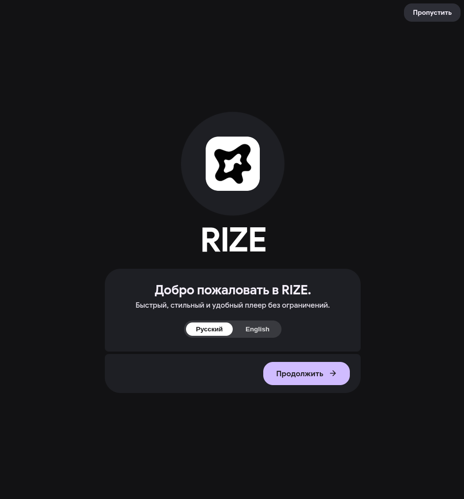
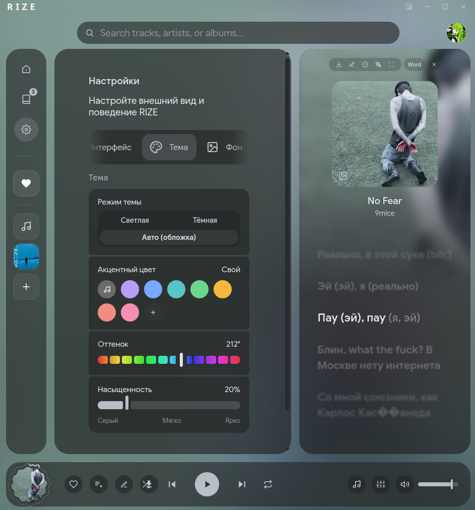
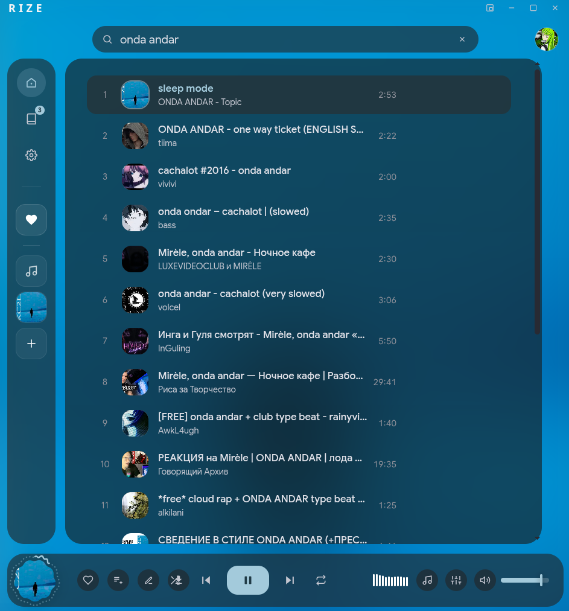
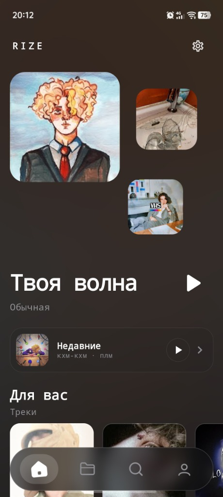
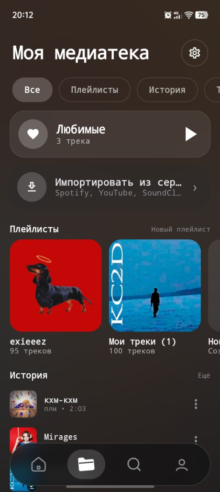
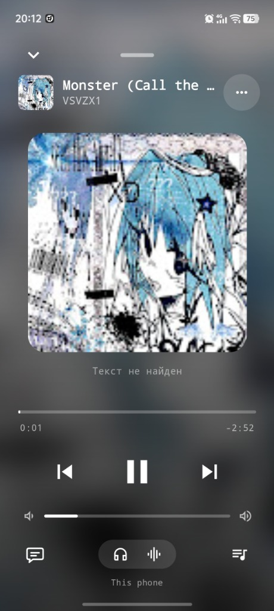
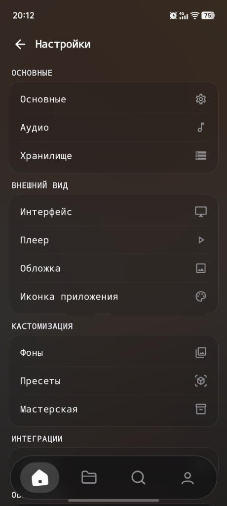

<p align="center">
  
  
</p>
<p align="center">
  
  
</p>
<p align="center">
  
</p>

### 📱 Мобильное приложение (Android Material You)

<p align="center">
  
  
  
  
</p>

## Офлайн демо-каталог
Если YouTube/SoundCloud недоступны (нет сети, файрвол, песочница), поиск и рекомендации автоматически возвращают локальный демо-каталог из 8 треков: аудио синтезируется на лету в памяти (WAV 22 кГц), обложки — генерируемые SVG. Треки играются, добавляются в плейлисты и закрывают все экраны контентом. Отключается переменной окружения `RIZE_DEMO=0` (или `VOTIFY_DEMO=0`). Файлов на диске не создаётся.

## Установка (готовые сборки)

Готовые релизные сборки v1.4.0 доступны для прямой загрузки:

| Система | Файл | Прямая ссылка |
|---|---|---|
| **Android** | `RIZE.apk` | [Скачать RIZE.apk](https://gitlab.com/exieeez/rize/-/raw/releases/RIZE.apk?inline=false) |
| **Linux (AppImage)** | `RIZE.AppImage` | [Скачать RIZE.AppImage](https://gitlab.com/exieeez/rize/-/raw/releases/RIZE.AppImage?inline=false) |
| **Windows** | `RIZE-Setup-1.4.0.exe` | [Скачать RIZE Setup 1.4.0.exe](https://gitlab.com/exieeez/rize/-/raw/releases/RIZE-Setup-1.4.0.exe?inline=false) |

Одной командой на Linux — скачает AppImage, положит в `~/.local/bin` и добавит ярлык
в меню приложений (root не нужен):

```bash
curl -fsSL https://github.com/exieeez/RIZE/releases/latest/download/install.sh | bash
```

Если релизный файл ещё не опубликован, тот же скрипт лежит в репозитории:

```bash
curl -fsSL https://raw.githubusercontent.com/exieeez/RIZE/pc/scripts/install.sh | bash
```

Тем же скриптом: `... | bash -s -- --deb` — поставить пакет через dpkg (Debian/Ubuntu),
`--version v1.0.0` — конкретная версия, `--uninstall` — удалить.

На Windows скачайте `.exe` из Releases и запустите — установщик сам предложит папку и ярлык.

## Сборка и запуск

### Требования
- Node.js (v20+)
- npm

> 📱 **Android-версия** RIZE лежит в этом же репозитории в каталоге `android/` (Kotlin, Room, оффлайн-загрузки). Ветка для телефона — `mobile`, для компьютера — `pc`; обе содержат весь проект целиком, различаются только линией релиза (см. «Ветки репозитория» ниже).

### Установка зависимостей
```bash
npm install
```

### Запуск в режиме разработки
```bash
npm start
```

### Discord Rich Presence

Application ID RIZE уже встроен в приложение, поэтому дополнительная настройка переменных окружения не требуется. Запустите Discord Desktop, затем RIZE:

```bash
npm install
npm start
```

RIZE показывает в Discord название трека, исполнителя, обложку и таймлайн воспроизведения. На паузе таймлайн скрывается, чтобы он не продолжал идти; после возобновления или перемотки он автоматически синхронизируется.

При необходимости встроенный Application ID можно переопределить:

```bash
RIZE_DISCORD_CLIENT_ID=другой_application_id npm start
```

Для локальных треков без публичной обложки можно дополнительно указать ключ изображения, загруженного в Rich Presence Art Assets:

```bash
RIZE_DISCORD_LARGE_IMAGE_KEY=rize npm start
```


#### Мастерская тем

Встроенная мастерская хранит публичные темы в `workshopThemes/{themeId}`. Просматривать, искать и устанавливать темы можно без аккаунта; публиковать и удалять собственные темы могут только постоянные Email/Google-аккаунты. Гостевые аккаунты перед публикацией нужно привязать.

После обновления приложения обязательно повторно опубликуйте `firestore.rules` в Firebase Console. Правила разрешают только безопасный набор цветов и параметров, а также HTTPS-ссылку на фон длиной до 2048 символов; запрещают изменение публикаций и позволяют удаление только владельцу. Локальные изображения, HTTP-ссылки и произвольный CSS в мастерскую не загружаются.

Правила также можно опубликовать через Firebase CLI (при первом использовании откроется вход Google):

```bash
npx firebase-tools@15.26.0 login
npm run deploy:firestore-rules
```

### Сборка релизных дистрибутивов (Linux AppImage & deb)

```bash
# Сборка AppImage & deb (Linux)
npx electron-builder --linux AppImage deb

# Сборка .exe (Windows)
npm run build:win
```

Собраные файлы будут находиться в папке `dist/`.

---

## Ветки репозитория

* **`pc`** — версия для компьютера (Electron + сервер + веб-интерфейс);
* **`mobile`** — версия для телефона (Android-приложение, APK собирается из неё);
* временные ветки `arena/*` живут только на время сессий разработки.

Как перестроить ветки (две основные вместо временных) и как залить на GitHub актуальную
папку с компьютера — **[docs/GIT-BRANCHES.md](docs/GIT-BRANCHES.md)**, скрипты:
`scripts/git-split-branches.sh` и `scripts/push-folder.ps1`.

## RIZE на телефоне (ярлык в браузере)

Пока приложение запущено на компьютере, тот же интерфейс открывается с телефона — ярлыком
на домашнем экране, без установки APK и без App Store:

1. Узнайте адрес этого компьютера в Wi-Fi сети: при запуске сервер печатает строку
   `RIZE на телефоне: http://192.168.1.10:17217`; тот же адрес видно в `ipconfig`
   (Windows) или `ip a` (Linux). Порт — `17217`.
2. Телефон в той же Wi-Fi сети открывает этот адрес в браузере.
3. **iPhone:** «Поделиться» → «На экран „Домой“». **Android:** меню «⋮» → «Установить
   приложение» (или «Добавить на главный экран»).

Интерфейс сам перестраивается под телефон (нижняя навигация, компактный плеер, отступы под
вырез и «домашнюю полоску»). Ярлык задаётся файлами `src/manifest.webmanifest`,
`src/icons/*` и apple-мета в `src/index.html` (иконки пересобираются скриптом
`scripts/generate-web-icons.sh`).

Что важно знать:

- музыка идёт **с компьютера** (yt-dlp на ПК), поэтому пока он выключен — телефон ничего не
  сыграет; телефон и ПК должны быть в одной сети;
- адрес — обычный `http://`, а не `https://`: ярлык и воспроизведение работают, но
  service worker/офлайн-кэш браузер в таком режиме не разрешает (ограничение iOS/Chrome,
  а не RIZE);
- на iOS воспроизведение продолжается при свёрнутом браузере, но система может остановить
  звук при блокировке экрана — это политика Safari;
- если адрес не открывается — разрешите RIZE доступ в брандмауэре Windows (входящие
  подключения, порт 17217).
