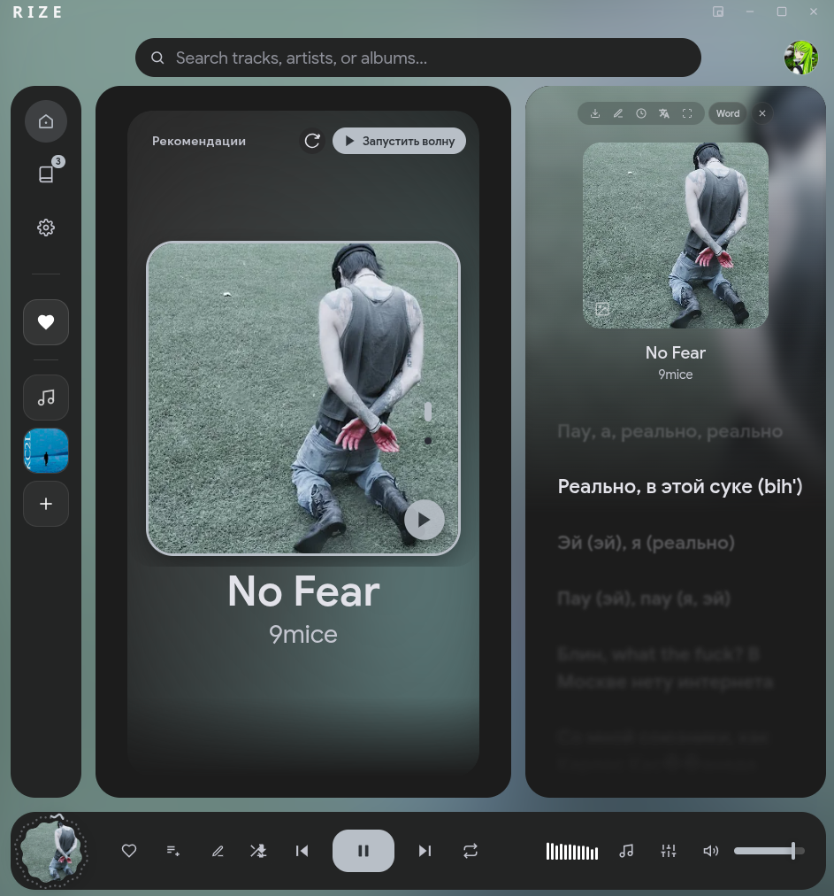
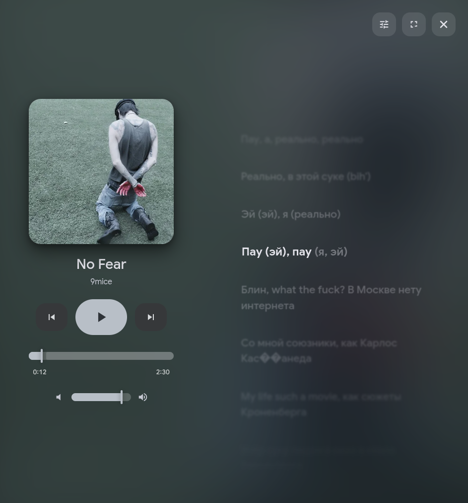

<div align="center">

  

  # RIZE Music

  **Сверхбыстрый кроссплатформенный музыкальный плеер и стриминг с открытым исходным кодом.**  
  *Нативный движок на **Rust (Tauri 2)** для ПК и **Jetpack Compose (Kotlin)** для Android.*

  <p align="center">
    <a href="https://github.com/exieeez/RIZE/releases"></a>
    <a href="https://www.rust-lang.org/"></a>
    <a href="https://tauri.app/"></a>
    <a href="https://developer.android.com/"></a>
    <a href="LICENSE"></a>
  </p>

  <p align="center">
    <b>Без рекламы • Без подписок • 100% Open Source • Приватность данных • Синхронный караоке-текст • Офлайн режим</b>
  </p>
</div>

---

## ⚡ О проекте

**RIZE** — это легковесный, быстрый и современный музыкальный плеер нового поколения.

В отличие от большинства музыкальных приложений, потребляющих сотни мегабайт оперативной памяти из-за тяжеловесных платформ, ядро десктопной версии RIZE написано на **Rust**. Это гарантирует минимальное потребление ресурсов (~35–50 МБ RAM), мгновенный запуск, безопасность памяти и аппаратную плавность интерфейса на 120+ FPS.

<p align="center">
  
  
</p>

---

## ✨ Ключевые возможности

- 🦀 **Нативный Rust-бэкенд (`src-tauri/`)**:
  - Многопоточный асинхронный движок на **Tokio** и **Axum**.
  - Нативный резолвер стримов, кэширование и прямой парсинг метаданных треков/артистов.
  - Потребление оперативной памяти в 5–10 раз ниже стандартных Electron-клиентов.
- 📱 **Нативное Android-приложение (`android/`)**:
  - Написано на **Kotlin** с декларативным UI на **Jetpack Compose (Material 3)**.
  - Фоновое воспроизведение через **Media3 ExoPlayer**, аппаратный эквалайзер и интеграция с системной шторкой.
  - Офлайн-база данных на **Room** и фоновый сервис загрузок.
- 📜 **Синхронизированный караоке-текст (LRC)**:
  - Автоскролл под ритм песни, эффект динамического размытия фоновых строк и подсветка активной фразы.
- 🎛️ **DSP-эффекты и 10-полосный эквалайзер**:
  - Пресеты: *Slowed + Reverb*, *Speed Up*, *Nightcore*, *Deep Bass*.
  - Плавная регулировка скорости воспроизведения (0.25x – 2.5x) с независимым питч-шифтером.
- 🎨 **Liquid Glass & AMOLED Дизайн**:
  - Настоящий чистый чёрный (#000000) для OLED-экранов, утончённая светлая тема и настраиваемое матовое стекло (Glassmorphism).
  - Адаптивный фоновый эмбиент, подстраивающийся под цветовую гамму текущей обложки трека.
- 💾 **Офлайн-режим и загрузки**:
  - Скачивание треков и плейлистов целиком в OPUS / MP3 для прослушивания без интернета.
- 🎮 **Discord Rich Presence**:
  - Нативная трансляция трека, обложки, исполнителя и таймлайна в ваш статус Discord.

---

## 🛠️ Архитектура и стек технологий

```
RIZE/
├── src-tauri/             # Нативное десктопное ядро на Rust (Tauri 2)
│   ├── src/
│   │   ├── server/        # Внутренний стриминг-сервер (Tokio, Axum, Reqwest)
│   │   │   ├── stream.rs  # Потоковая передача и оптимизация аудио
│   │   │   ├── lyrics.rs  # Синхронизация и парсер караоке-текстов
│   │   │   ├── search.rs  # Поисковый движок по каталогам
│   │   │   └── artist.rs  # Профили артистов и дискография
│   │   └── lib.rs         # Tauri commands, трей, системные вызовы
│   └── Cargo.toml         # Зависимости Rust
│
├── android/               # Нативное мобильное приложение для Android
│   ├── app/src/main/
│   │   └── java/          # Jetpack Compose UI, Room, Media3 Service
│   └── build.gradle.kts   # Конфигурация Android сборки
│
└── src/                   # Веб-компоненты интерфейса (Preact, HTML5, CSS3)
```

---

## 📥 Загрузка готовых сборок (v1.4.0)

Релизные пакеты доступны на странице [Releases](https://github.com/exieeez/RIZE/releases):

| Платформа | Формат | Загрузка |
|---|---|---|
| **Android** | `.apk` | [Скачать RIZE.apk](https://github.com/exieeez/RIZE/releases/latest/download/rize.apk) |
| **Linux** | `.AppImage` | [Скачать RIZE.AppImage](https://github.com/exieeez/RIZE/releases/latest/download/RIZE.AppImage) |
| **Windows** | `.exe` | [Скачать RIZE-Setup.exe](https://github.com/exieeez/RIZE/releases/latest/download/RIZE-Setup-1.4.0.exe) |

---

## 🚀 Сборка из исходников

### Требования
- **Rust** (версия 1.80+): `curl --proto '=https' --tlsv1.2 -sSf https://sh.rustup.rs | sh`
- **Node.js** (v20+) & **npm**
- **Android Studio / JDK 17** (для сборки Android APK)

### 1. Десктопная версия (Rust + Tauri)
```bash
# Клонирование репозитория
git clone https://github.com/exieeez/RIZE.git
cd RIZE

# Установка зависимостей
npm install

# Запуск в режиме разработки (Rust + Frontend)
npm run tauri dev
# или
cargo tauri dev

# Сборка релизного бинарника
npm run tauri build
```

### 2. Мобильная версия (Android)
```bash
cd android

# Запуск юнит-тестов
./gradlew test

# Сборка Release APK
./gradlew assembleRelease
# Сборка Debug APK
./gradlew assembleDebug
```
Собранный файл будет находиться по пути: `android/app/build/outputs/apk/release/app-release.apk`.

---

## 📄 Лицензия

Этот проект распространяется под свободной лицензией **MIT**. Подробности в файле [LICENSE](LICENSE).

---

<div align="center">
  <sub>Создано с ❤️ сообществом Open Source.</sub>
</div>
